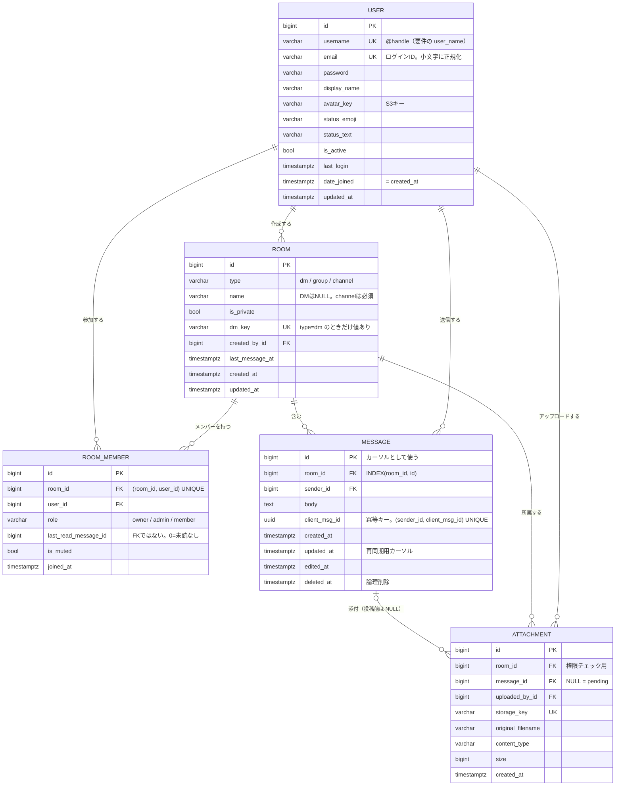

# Step 2：データモデル

コード：[backend/accounts/models.py](../backend/accounts/models.py) / [backend/chat/models.py](../backend/chat/models.py)

## 2-1. ER図



## 2-2. 元の案からの変更点と理由

| # | 対象 | 変更 | 理由 |
|---|---|---|---|
| 1 | User | `user_name` は AbstractUser の `username` 列をそのまま流用 | createsuperuser・管理画面・バリデータが `username` を前提にしている。別名の列を足すと、同じ意味の列が2つできる |
| 2 | User | `created_at` は持たず `date_joined` を使う。`first_name` / `last_name` は削除 | 列の重複と未使用列をなくす |
| 3 | User | email を保存時とログイン時に小文字へ正規化 | `Foo@x.com` と `foo@x.com` が別アカウントになる事故を防ぐ |
| 4 | Room | `dm_key` ＋部分ユニーク制約 | DM の重複を **DB で** 保証する（2-3） |
| 5 | Room | type ごとの列の整合性を CheckConstraint で強制し、チャンネル名は大文字小文字を区別せずユニークにする | 「名前つきDM」「公開DM」のような矛盾した行を作れなくする |
| 6 | RoomMember | `last_read_message_id` は FK ではなく BigInteger（初期値 0） | メッセージの削除に引きずられない。「どこまで読んだか」は位置情報であって参照ではない |
| 7 | RoomMember | `(user, room)` の逆順インデックスを追加 | ユニーク制約 `(room, user)` は「ルーム→メンバー」の検索にしか効かない。「自分のルーム一覧」は user 起点になる |
| 8 | Message | `id` を BigAutoField にし、`updated_at` を追加 | id はカーソルとして使う。`updated_at` は切断中に起きた編集・削除を拾うため（2-5） |
| 9 | Message | 単独の `room_id` インデックスを作らない | `(room_id, id)` の複合インデックスが先頭列で代用できるので冗長になる |
| 10 | Attachment | `room` を追加し、`message` を NULL 許可にする | アップロードはメッセージ投稿より **前** に起きる。紐付け前でも権限チェックできるようにする（2-6） |
| 11 | Message | `client_msg_id`（UUID）と `(sender, client_msg_id)` の部分ユニーク制約を追加（Step 3 で追加） | 送信リトライによる二重投稿の防止（冪等キー）と、楽観的 UI の仮メッセージを確定メッセージと突き合わせるため |

## 2-3. 同じ2人の DM の重複をどう防ぐか

「先に SELECT して、無ければ INSERT」というアプリ側だけのチェックでは、**2人が同時に DM を開くと両方の SELECT が「無い」と判定して2つできてしまう**（典型的な競合状態）。DB の制約で守るしかない。

| 案 | 方法 | 評価 |
|---|---|---|
| A. アプリ側でチェック | SELECT → INSERT | ✗ 同時実行で重複する |
| **B. `dm_key` 列（採用）** | `"小さいid:大きいid"` を入れ、`type='dm'` の行だけにユニーク制約をかける | ◎ 1列で済み、`get_or_create` で扱える |
| C. DM専用テーブル | `(user_low_id, user_high_id)` に UNIQUE ＋ `CHECK(low < high)` | ○ FK で整合性まで守れるが、テーブルと JOIN が増える |

ID を **ソートしてから** キーにするのが要点。A→B でも B→A でも同じキー `"3:7"` になる。

```python
@transaction.atomic
def get_or_create_dm(me, other) -> Room:
    room, created = Room.objects.get_or_create(
        type=Room.Type.DM,
        dm_key=Room.make_dm_key(me.id, other.id),
        defaults={"created_by": me},
    )
    if created:
        RoomMember.objects.bulk_create([
            RoomMember(room=room, user=me),
            RoomMember(room=room, user=other),
        ])
    return room
```

同時に呼ばれた場合、後の INSERT はユニークインデックスで待たされ、先のトランザクションがコミットした時点で IntegrityError になる。`get_or_create` はこれを捕まえて SELECT し直すので、**両者とも同じルームを受け取る**。Room と RoomMember を同じトランザクションで作っているので、「ルームはあるのにメンバーがいない」瞬間も外から見えない。

自分自身との DM は MVP では API 側で拒否する。

## 2-4. Room の type の定義

| type | 人数 | name | is_private | 新しいメンバーの参加 |
|---|---|---|---|---|
| dm | 2 | NULL | 常に true | 不可 |
| group | 3人以上 | 任意（NULL ならメンバー名を並べて表示） | 常に true | メンバーが追加する |
| channel | 1人以上 | 必須（大文字小文字を区別せずユニーク） | 選べる | 公開は誰でも参加できる。非公開は招待のみ |

## 2-5. メッセージ id をカーソルにするときの落とし穴と対策

### 落とし穴：id の採番順とコミット順は一致しない

```
tx A: id=100 を採番 ……（遅い）…… COMMIT
tx B:    id=101 を採番 → COMMIT
クライアント：101 を受信 → 切断 → 再接続して ?after=101 → 100 を永久に取りこぼす
```

### 対策：送信時にルームの行をロックしてから INSERT する

```python
with transaction.atomic():
    room = Room.objects.select_for_update().get(pk=room_id)  # ← 同じルームへの書き込みは直列化される
    msg = Message.objects.create(room=room, ...)
    room.last_message_at = msg.created_at
    room.save(update_fields=["last_message_at", "updated_at"])
```

`last_message_at` はどのみち更新する必要があるので、そのためのロックを兼ねられる。直列化されるのは **同じルームへの投稿だけ** で、100人規模なら性能上の問題はない。カーソルはルーム単位なので、ルーム内で順序が保証されれば十分。

### もう1つの落とし穴：`after=` では切断中の編集・削除を拾えない

編集・削除では新しい id が増えないため。そこで `Message.updated_at` を持たせ、再接続時には `?changed_since=<最後に受け取ったイベントのサーバー時刻>` でも取得する。具体的なAPIは Step 3、イベントは Step 4 で決める。

## 2-6. Attachment のライフサイクル

```
presign 要求 ──▶ Attachment(message=NULL) 作成 ──▶ ブラウザが S3 に PUT
                                                    │
メッセージ投稿(attachment_ids) ──▶ S3 に HEAD して実在と実サイズを確認 ──▶ message を紐付け
                                                    │
一定時間 NULL のまま ──▶ 孤児として S3 の実体ごと削除（部分インデックス idx_attachment_pending を使う）
```

- `storage_key` は `attachments/{room_id}/{uuid4}` にする。ユーザーが付けたファイル名はキーに使わない（文字コードやパストラバーサルの問題を避ける）。元のファイル名はダウンロード時の `Content-Disposition` で復元する。
- 「Attachment.room == Message.room」はテーブルをまたぐので CHECK 制約では書けない。紐付け処理（サービス層）で検証する。
- 削除済みメッセージの添付は API から返さず、ダウンロードも拒否する。

## 2-7. 論理削除

`deleted_at` を入れると同時に `body` を空にする。削除されたはずの本文が API や DB ダンプに残らないようにするため。行自体は残すので、相手の画面には「このメッセージは削除されました」と表示でき、未読数の計算やカーソルの連続性も壊れない。

## 2-8. 未読数の計算

```sql
SELECT rm.room_id, COUNT(m.id) AS unread
FROM chat_roommember rm
LEFT JOIN chat_message m
       ON m.room_id = rm.room_id
      AND m.id > rm.last_read_message_id      -- (room_id, id) インデックスの範囲スキャン
      AND m.deleted_at IS NULL
      AND m.sender_id <> rm.user_id           -- 自分の投稿は未読に数えない
WHERE rm.user_id = :me
GROUP BY rm.room_id;
```

| 方式 | 長所 | 短所 |
|---|---|---|
| **都度 COUNT（採用）** | 常に正しい。編集・削除の影響も自動で反映される | 未読が数万件あると遅い |
| RoomMember に未読カウンタ列を持つ | 読むのが O(1) | 投稿のたびに全メンバー分の UPDATE が発生する。削除時の補正も必要でズレやすい |

想定は100人規模なので都度 COUNT で十分。チャンネル参加時には `last_read_message_id` に参加時点の最新 id を入れ、過去ログが全部未読にならないようにする。

## 2-9. 時刻

`USE_TZ = True` にすると、PostgreSQL では `timestamptz` で保存され、Django は UTC の aware datetime として扱う。API は ISO 8601（`2026-11-05T05:00:00Z`）で返し、フロントで JST に変換して表示する。
